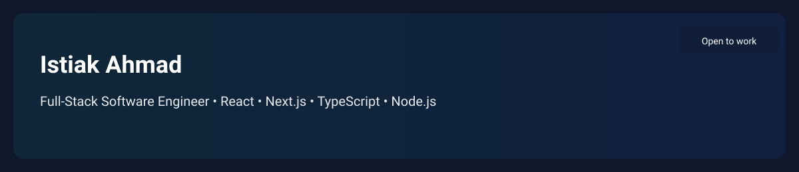

# Hi, I'm Istiak Ahmad 👋

Full‑Stack Software Engineer • React • Next.js • TypeScript • Node.js

Building production-ready, maintainable web applications that solve real business problems using clean architecture and modern tooling. I combine practical engineering with AI-assisted workflows.

---

## 🔭 Now
Working on building scalable full‑stack SaaS apps and improving developer productivity with AI tooling.

## ✨ Highlights
- Strong focus on clean, testable code and practical architecture
- Experience building authentication, admin dashboards, and REST APIs
- Passion for open-source, developer tooling, and performance optimization

---

## 📌 Pinned Projects

### 🏥 [Population-Based Cancer Registry](https://github.com/istiakahmad62/Population-Based-Cancer-Registry) · [Live Demo](https://next-app-pop-based.vercel.app)
Health data platform for recording, tracking and analysing cancer and disease cases at the household level.
- Secure login and sign-up with NextAuth (JWT) and middleware-protected routes
- Multi-step data-entry forms for household, member, cancer, stroke and disease records, validated with React Hook Form + Zod
- Patient follow-up tracking, user management and a full activity log
- Statistics dashboards by cancer type, disease and risk factor with Chart.js, plus filtering and data export

`Next.js 14` `TypeScript` `NextAuth` `React Query` `React Hook Form` `Zod` `Ant Design` `shadcn/ui` `Tailwind CSS` `Chart.js`

### 🏨 [Hotel Venue System — Retreat](https://github.com/istiakahmad62/Hotel-Venue-System)
Full-stack app for discovering and booking venues for team offsites.
- REST API for filtering venues by city, capacity and price, plus booking inquiries with Zod validation (capacity limits, date ranges, no past dates)
- Search page with live filtering, venue detail pages, and a validated booking form with loading and error states
- Prisma schema with a seed script (SQLite by default, PostgreSQL-ready)

`Next.js 15` `TypeScript` `Prisma` `Zod` `Tailwind CSS`

---

## 🛠 Tech Stack
React • Next.js • TypeScript • Node.js • Express • PostgreSQL • Prisma • Tailwind CSS • Docker • Vercel • Git

---

<!-- Small, reliable badges for quick profile info -->

Quick links
- Profile overview: https://github.com/istiakahmad62
- Repositories: https://github.com/istiakahmad62?tab=repositories
- Starred repos: https://github.com/istiakahmad62?tab=stars
- Followers: https://github.com/istiakahmad62?tab=followers

---

## 🎯 2026 Goals
- Build production‑ready SaaS products that deliver measurable value  
- Contribute to meaningful open‑source projects  
- Grow as a Full‑Stack Product Engineer focused on outcomes

---

## 🤝 Connect
- LinkedIn — https://www.linkedin.com/in/md-istiak-ahmad/  
- Email — istiak.corporate@gmail.com

> "Great software is built by understanding problems first and writing code second."
